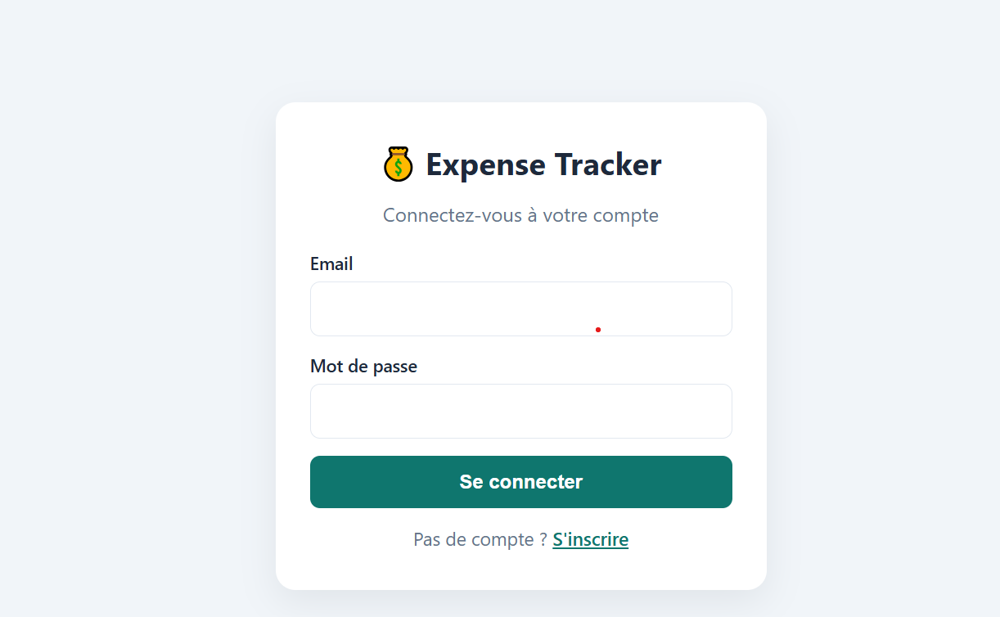
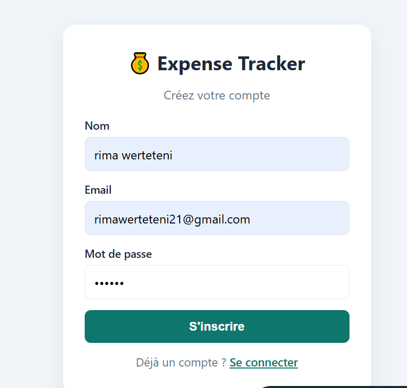
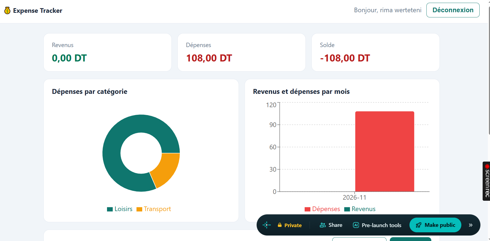
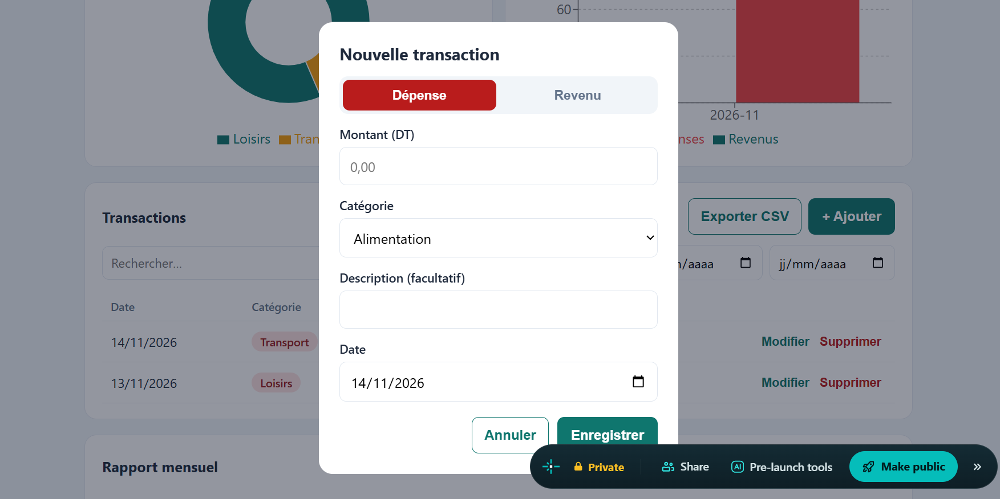
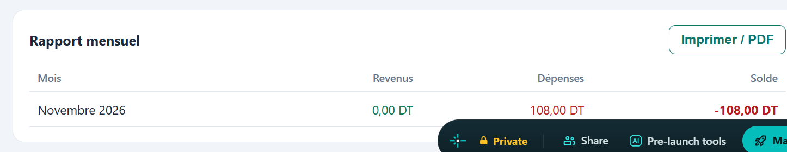
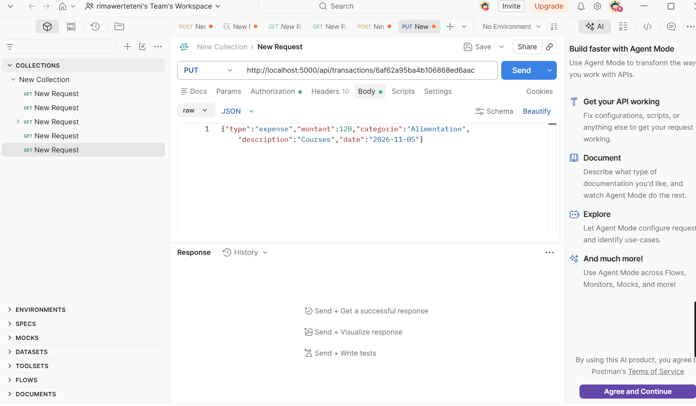

# Expense Tracker

Application web de suivi de revenus et de dépenses avec comptes utilisateurs, tableau de bord, graphiques et rapports mensuels. Réalisée dans le cadre du stage **Full Stack Development – Auspify Technologies** (Tâche 3).

## Liens

| | Adresse |
|---|---|
| Application | [https://expense-tracker-rima.netlify.app/] |
| API | [https://expense-tracker-api-q1ws.onrender.com] |
| Code source | [https://github.com/LSIri2020/expense-tracker.git] |

> L'API est sur le plan gratuit de Render : après une période d'inactivité, le premier chargement peut prendre **30 à 60 secondes**.

## Fonctionnalités

- Inscription et connexion sécurisées (JWT, mots de passe hachés avec bcrypt)
- Chaque utilisateur voit uniquement ses propres données
- Ajout, modification et suppression de revenus et de dépenses
- Catégories, description et date pour chaque transaction
- Recherche et filtres (type, catégorie, période)
- Tableau de bord : total des revenus, des dépenses et solde
- Graphiques : dépenses par catégorie, revenus et dépenses par mois
- Rapport mensuel, impression en PDF et export CSV
- Interface responsive (ordinateur et téléphone)

## Technologies

| Partie | Technologies |
|---|---|
| Frontend | React (Vite), React Router, Recharts |
| Backend | Node.js, Express.js, JWT, bcryptjs |
| Base de données | MongoDB Atlas, Mongoose |
| Déploiement | Netlify (frontend), Render (backend) |

## API REST

Toutes les routes `/api/transactions` exigent l'en-tête `Authorization: Bearer <token>`.

| Méthode | Route | Description |
|---|---|---|
| POST | `/api/auth/register` | Créer un compte (201, 400, 409) |
| POST | `/api/auth/login` | Se connecter (200, 401) |
| GET | `/api/auth/me` | Utilisateur connecté (200, 401) |
| GET | `/api/transactions` | Lister (filtres : `type`, `categorie`, `from`, `to`, `search`) |
| GET | `/api/transactions/stats` | Totaux, solde, par catégorie, par mois |
| GET | `/api/transactions/:id` | Détail d'une transaction |
| POST | `/api/transactions` | Ajouter (201, 400) |
| PUT | `/api/transactions/:id` | Modifier (200, 400, 404) |
| DELETE | `/api/transactions/:id` | Supprimer (200, 404) |

## Installation en local

Prérequis : Node.js, un compte MongoDB Atlas, Git.

```bash
git clone [LIEN-GITHUB]
cd expense-tracker
```

**Backend**
```bash
cd backend
npm install
```
Créez `backend/.env` (renseignez vos propres valeurs) :
```env
PORT=
MONGO_URI=
JWT_SECRET=
CLIENT_URL=
```
```bash
npm run dev
```

**Frontend** (dans un second terminal)
```bash
cd frontend
npm install
```
Créez `frontend/.env` :
```env
VITE_API_URL=
```
```bash
npm run dev
```

## Captures d'écran

| Connexion | Inscription |
|---|---|
|  |  |

| Tableau de bord | Ajout d'une transaction |
|---|---|
|  |  |

| Graphiques | Rapport mensuel |
|---|---|
|  |  |

| Téléphone | Test API (Postman) |
|---|---|
|  |  |

## Auteure

Rima Werteteni, développeuse Full Stack
LinkedIn : https://linkedin.com/in/rima-werteteni